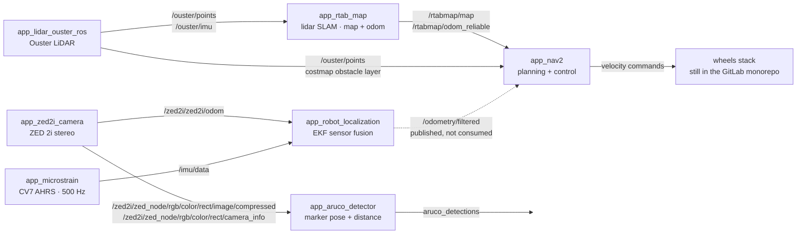
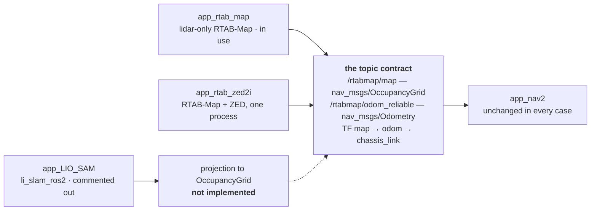
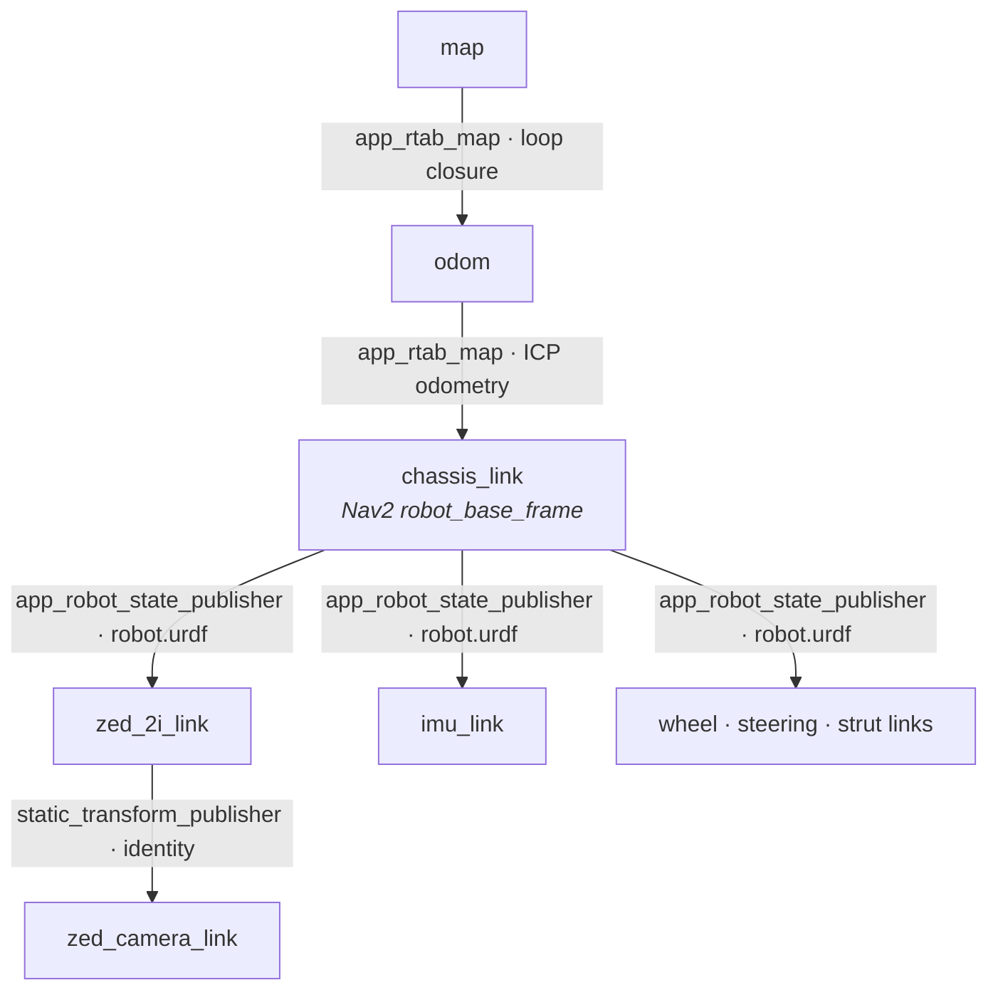

# Architecture

Every subsystem is its own ROS 2 package, Dockerfile, and Compose service. They know
nothing about each other except the topics they exchange — which is what makes any one
of them swappable.

## The runtime graph

Three drivers put raw data on the bus. RTAB-Map turns lidar into a map and an odometry
estimate. Nav2 consumes those and plans. Every edge below is a topic; nothing in the
chain reaches into anything else.



Two things worth knowing that the graph makes visible:

- **`/ouster/points` is consumed twice** — once by RTAB-Map for SLAM, and again directly
  by both Nav2 costmaps as an obstacle layer.
- **`/odometry/filtered` has no subscriber.** The EKF publishes it, but Nav2 takes its
  odometry from `/rtabmap/odom_reliable`. The dashed edge is available, not wired.

## Why it is built in separable pieces

The modularity is deliberate, and it buys two specific things: you can **swap an
implementation** without touching its neighbours, and you can **bring up a subset** to
test one thing in isolation.

Both work for the same reason — a package's only contract with the rest of the stack is
the set of topics it consumes and produces. Anything that honours that contract is a
drop-in replacement. The SLAM slot is where this has actually paid off: three different
back-ends have occupied it.



Two back-ends satisfy the contract directly and can be exchanged by editing one Compose
service. LIO-SAM cannot — it publishes its map as a `PointCloud2`, not an occupancy
grid, so it needs a projection step before Nav2 can plan on it. That gap, not packaging,
is why its Compose service is still commented out.

### Testing a subset

Because each package is its own Compose service, bringing up part of the stack is the
normal case rather than a special mode — useful on a bench with one sensor plugged in.

```bash
# lidar + SLAM only, no camera, no planner
docker compose up app_lidar_ouster_ros app_rtab_map

# camera + marker detection, nothing else
docker compose up app_zed2i_camera app_aruco_detector

# the whole stack
docker compose up
```

## The transform tree

Topics carry the data; TF carries the geometry that makes the data mean anything. Two
packages write this tree, and the split matters — SLAM owns the moving part, the URDF
owns the rigid part.



The identity transform from `zed_2i_link` to `zed_camera_link` is a deliberate bridge:
the URDF names the mount point, the Stereolabs driver names its own optical frame, and
the static publisher reconciles the two without either side having to rename anything.

## Package reference

What each package puts on the bus, and what it takes off it.

| Package | Subscribes | Publishes |
| --- | --- | --- |
| `app_zed2i_camera` | — hardware | `/zed2i/zed_node/rgb/color/rect/image[/compressed]`<br>`/zed2i/zed_node/rgb/color/rect/camera_info`<br>`/zed2i/zed_node/depth/depth_registered`<br>`/zed2i/zed_node/point_cloud/cloud_registered`<br>`/zed2i/zed2i/odom` |
| `app_lidar_ouster_ros` | — hardware | `/ouster/points`<br>`/ouster/imu` |
| `app_microstrain` | — hardware | `/imu/data` (driver default) |
| `app_rtab_map` | `/ouster/points` → `scan_cloud`<br>`/ouster/imu` | `/rtabmap/map`<br>`/rtabmap/odom_reliable`<br>TF `map → odom` |
| `app_rtab_zed2i` | `/ouster/points` → `scan_cloud`<br>`/ouster/imu` | same contract, composable node |
| `app_robot_localization` | `/zed2i/zed2i/odom` → `/odom` | `/odometry/filtered` |
| `app_nav2` | `/rtabmap/map`<br>`/rtabmap/odom_reliable`<br>`/ouster/points` | velocity commands |
| `app_aruco_detector` | `…/rect/image/compressed`<br>`…/rect/camera_info` | `aruco_detections` |
| `app_robot_state_publisher` | `robot.urdf` | `/tf`<br>`/tf_static` |
| `app_LIO_SAM` | `/ouster/points`<br>`/ouster/imu` | `/map`, `/modified_map` (PointCloud2)<br>`/path`, `/current_pose`, `/odom`<br>TF `map → chassis_link` |
| `app_zenoh_bridge` | — DDS bridge | carries the graph over unreliable WiFi |
| `app_template` | — | scaffold for the next subsystem |

Drawn from the launch files, Compose services and parameter YAML in this repository.
Where a topic is a driver default rather than an explicit remap — `/imu/data` — it is
marked as such.
